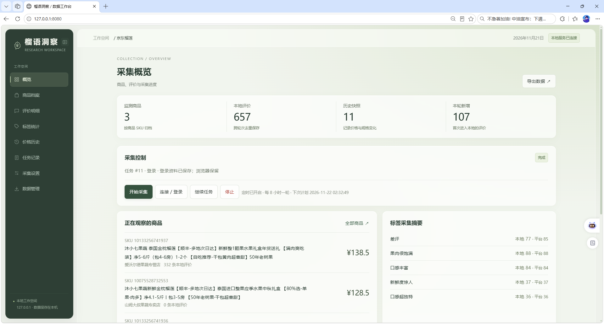
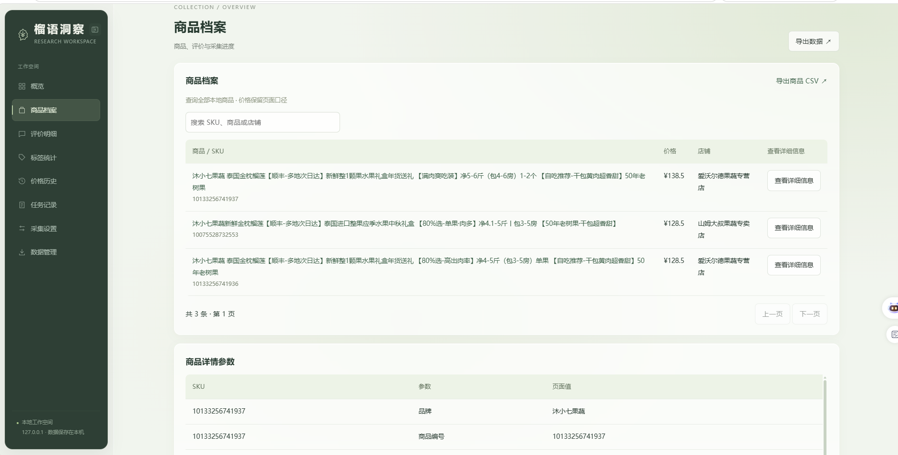
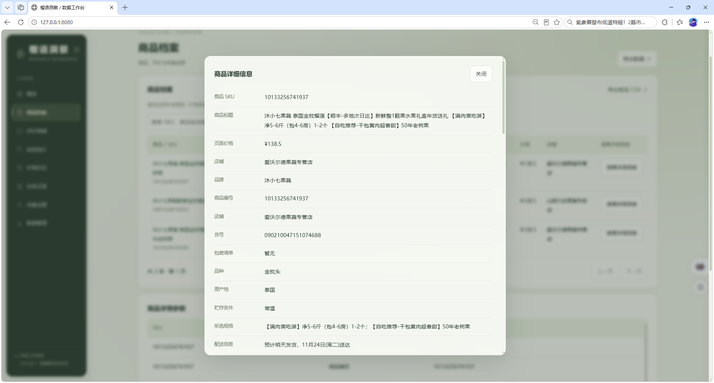
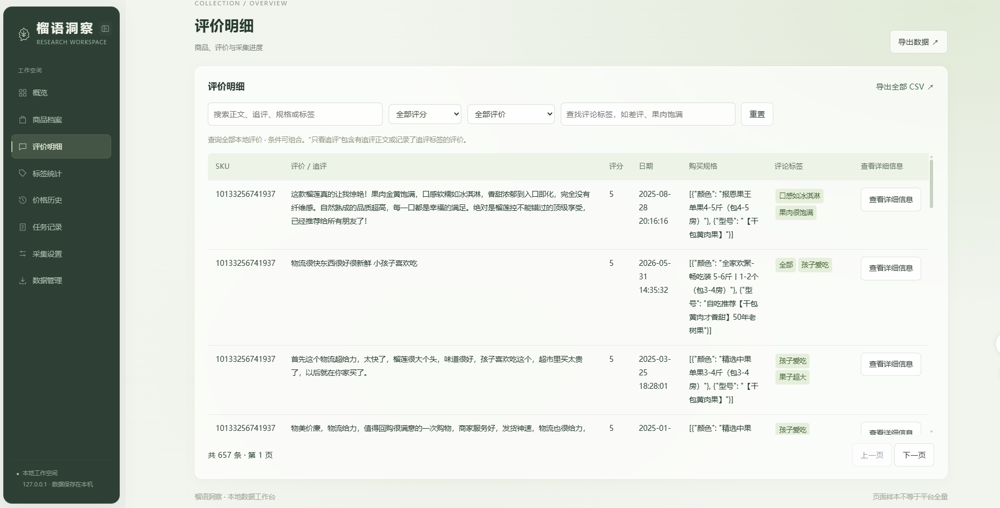
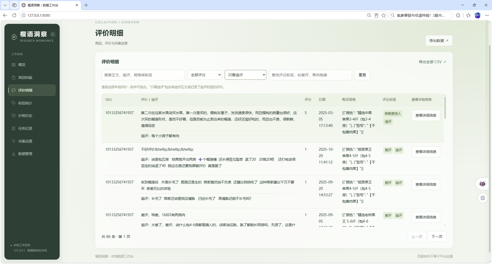
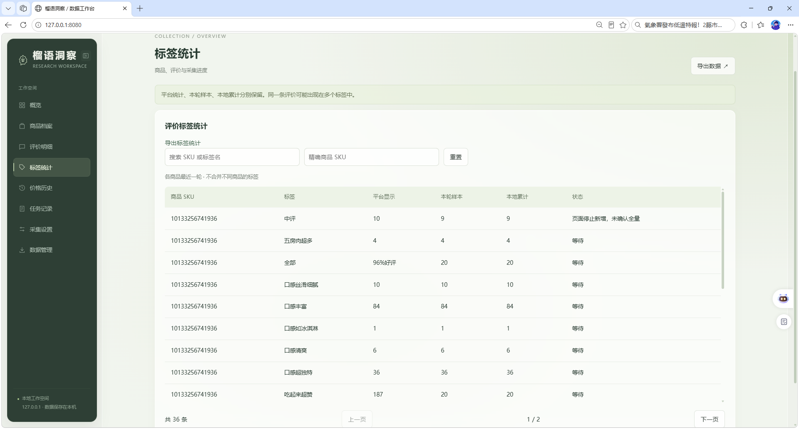
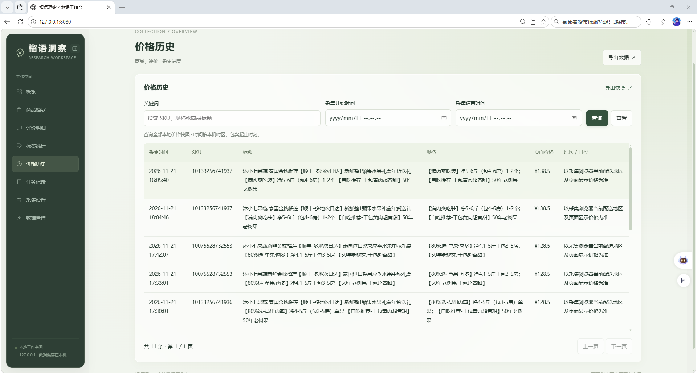
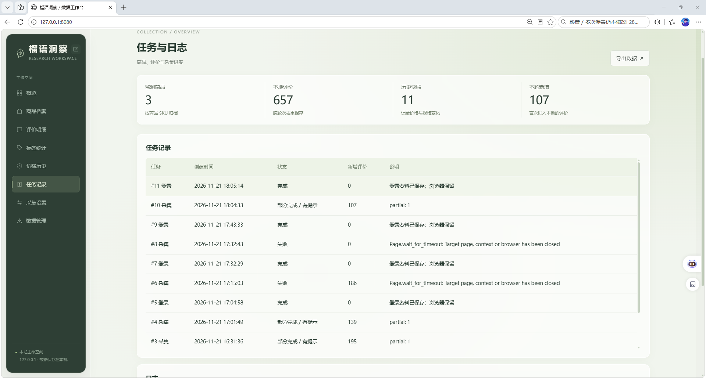
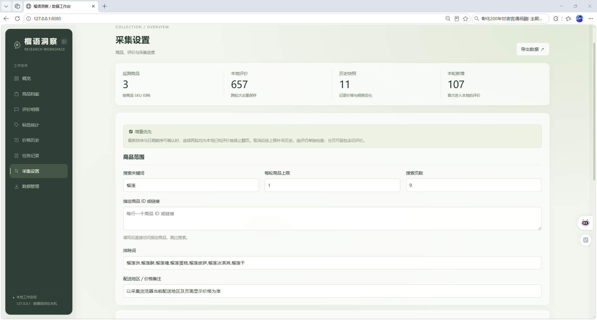
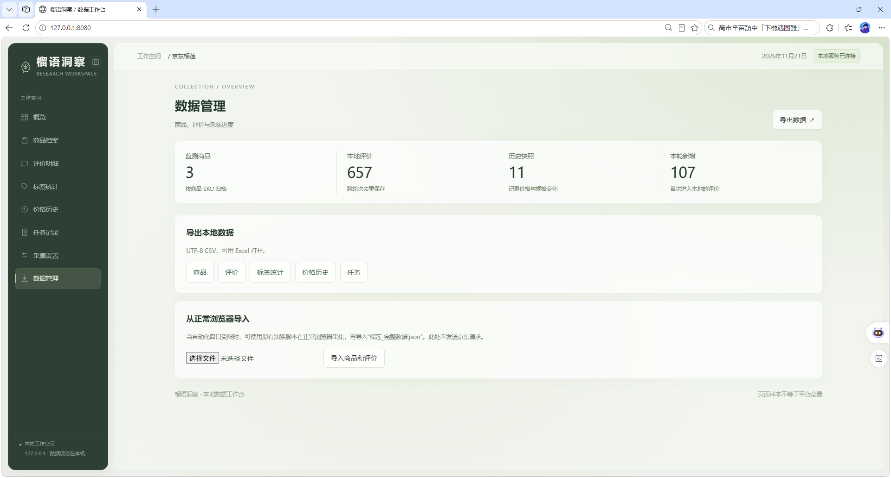

# 榴语洞察 · 京东商品与评价采集管理系统


基于 **Python + Playwright + Microsoft Edge + SQLite** 的本地京东商品、评价与价格监测工具，提供中文 Web 管理页面。以榴莲商品研究为使用场景，支持商品详情参数、评价与追评、标签统计、价格快照、关键词和时间查询、CSV 导出。

**Liuyu Insight — a local JD.com product and review collection dashboard built with Python, Playwright, Microsoft Edge and SQLite. Collect product attributes, customer reviews, follow-up reviews, review tags and price snapshots; search local records and export CSV.**

适合寻找“京东评价爬虫 / 京东评论采集 / JD review scraper / JD product crawler / Playwright 浏览器采集 / 商品价格监测”实现参考的人。当前商品参数提取和默认配置偏向榴莲生鲜，其他品类需自行验证和适配。

## 能做什么

- **商品采集**：指定 SKU 或京东商品链接；提供关键词搜索配置，搜索能否使用取决于京东页面与账号状态。
- **详情参数**：标题、页面价格、店铺、品牌、品种、原产地、贮存条件、商品编号等页面实际提供的参数；保存所选规格和图片链接等信息。
- **评价与追评**：评价正文、追评、评分、日期、购买规格，以及页面提供的图片、视频链接；按可见标签采集并优先处理差评。
- **标签统计**：按商品 SKU 分别保存平台显示数量、本轮样本数、本地累计和采集状态；同一评价可能属于多个标签。
- **去重与增量优先**：跨轮次去重；可确认最新排序与日期顺序时，以连续已知评价批次作为提前停止依据。它不是平台的“只返回新增评价”接口，仍可能加载旧评价，追评另行检查。
- **价格历史**：保存每轮价格与规格快照，支持按 SKU、标题、规格和采集起止时间组合查询、分页与重置。
- **本地管理页面**：商品和评价详情查看，评价正文、追评、规格、标签、评分等组合筛选，商品搜索、任务记录、日志、设置与数据导入导出。
- **运行管理**：手动开始、停止、继续任务；支持定时采集配置，电脑和后台服务需保持运行。
- **CSV 导出**：商品、评价、标签、价格快照和任务记录可导出，方便在 Excel、Python 等工具中继续分析。

当前商品和评价页面以查询、查看详情为主。此项目没有内置情感分析模型，也不承诺完整取得平台全部评价。

## 管理页面展示

以下展示本系统的管理页面。页面统计、本地样本与平台显示数量分别保留，不代表已获得平台全量数据。

<!-- 截图维护说明（仅在编辑 README 时显示）：
自行截取当前系统页面，将图片上传到仓库 docs/images/ 目录，使用下列文件名。
截图不应显示 Cookie、账号、手机号、浏览器个人资料或非必要的用户身份信息。
建议浏览器窗口宽度为 1440–1920 像素，统一窗口宽度；优先截网页内容，裁掉无关浏览器标签与桌面。
图片未上传前，下面的图片链接暂时不能显示。图片上传后会自动显示。
-->

### 1. 概览：数据规模与采集进度

集中展示监测商品、本地评价、历史快照与本轮新增数量，提供采集控制、商品摘要、标签摘要与最近日志。

<!-- 截图建议：打开“概览”，截取顶部统计卡片、采集控制和下方商品与标签摘要；页面较长可使用长截图。文件名 overview.png。 -->


### 2. 商品档案：商品查询与详情参数

按 SKU、商品标题或店铺查找本地商品，查看页面价格和店铺信息，并导出商品 CSV。参数表保留页面实际提取到的品牌、品种、原产地、贮存条件等字段。

<!-- 截图建议：打开“商品档案”，截取搜索框、商品列表和部分详情参数表；保证商品名称、SKU、价格与店铺清晰。文件名 products.png。 -->


点击“查看详细信息”，可集中查看商品参数、所选规格、链接及采集时间。

<!-- 截图建议：在商品列表点击“查看详细信息”，截取弹窗，选择能显示品牌、品种、原产地、贮存条件及规格的商品；正文不要被截断。文件名 product-detail.png。 -->


### 3. 评价明细：关键词、评分与标签组合筛选

可查询评价正文、追评、购买规格或评论标签，并结合评分、追评范围和标签条件筛选本地评价。列表保留商品 SKU，便于关联商品与规格。

<!-- 截图建议：打开“评价明细”，截取完整筛选栏和几条评价；让正文、评分、日期、规格、评论标签等列可见，避免只截局部。文件名 reviews.png。 -->


选择“只看追评”，可集中查看带追评正文或追评标签记录的评价；初评与追评一起展示，便于比较购买后的变化。

<!-- 截图建议：选择“只看追评”或“有追评正文”，挑选能同时看到初评和追评正文的记录，保留筛选条件。文件名 follow-up.png。 -->


### 4. 标签统计：平台数量与本地样本分别展示

按 SKU 或标签名查询，分别展示平台显示数量、本轮样本、本地累计与采集状态。同一评价可能命中多个标签，不应直接累加各标签样本作为评价总数。

<!-- 截图建议：打开“标签统计”，截取查询栏和表格；最好显示差评、追评等多个标签，以及商品 SKU、平台数量、本地数量和状态。文件名 tags.png。 -->


### 5. 价格历史：关键词与采集时间范围查询

支持按 SKU、商品标题或规格检索价格快照，并与采集起止时间组合筛选。列表保留采集时间、规格、页面价格与地区口径，支持分页、重置和导出。

<!-- 截图建议：打开“价格历史”，填写一个实际有记录的关键词和时间范围，点击“查询”；截取查询栏及结果，尽量展示同商品不同时间的快照。文件名 history.png。 -->


### 6. 任务记录：执行结果与运行日志

记录每轮任务的时间、状态、新增评价数与说明；通过日志了解采集进度、暂停原因或部分完成的情况。

<!-- 截图建议：打开“任务记录”，截取统计卡片、任务表和日志；选择说明易理解的记录。公开前检查日志中是否出现账号或本机敏感路径。文件名 tasks.png。 -->


### 7. 采集设置：商品范围、采集节奏与定时任务

设置关键词或指定商品 SKU、商品上限、评价上限、访问间隔、分类、滚动次数与定时周期，并可控制增量优先。

<!-- 截图建议：打开“采集设置”，展示增量优先、商品范围、采集上限及定时配置；可使用长截图。不要展示填有 Cookie 的输入框，也不要公开账号相关配置。文件名 settings.png。 -->


### 8. 数据管理：本地记录导入与 CSV 导出

集中导出商品、评价、标签、价格快照和任务 CSV，也支持导入兼容格式的完整 JSON 记录。数据导入不会自动触发新的平台采集。

<!-- 截图建议：打开“数据管理”，截取统计卡片及“导出本地数据”“从正常浏览器导入”两个栏目；不必选中本机文件，避免暴露文件路径。文件名 data.png。 -->


## 技术栈与工作方式

- **Python**：采集协调、数据处理与本地 HTTP 服务；服务使用标准库 `http.server`，没有引入 Django 或 FastAPI。
- **Playwright**：浏览器自动化、页面 DOM 提取及页面正常请求的响应解析。
- **Microsoft Edge / CDP**：打开独立采集浏览器，通过本机 Chrome DevTools Protocol 连接；登录状态保存在本机专用浏览器目录。
- **SQLite / sqlite3**：保存商品、评价、观察记录、标签、价格快照、任务、配置等信息。
- **HTML + CSS + 原生 JavaScript**：中文管理页面、玻璃态样式、可折叠侧栏、查询表单和分页。
- **PowerShell + CMD**：Windows 环境安装、后台启动、停止和浏览器启动入口。

采集流程：管理页面提交任务 → Python 协调任务 → Edge 打开京东页面 → Playwright 提取可访问的数据 → SQLite 保存 → 页面查询与 CSV 导出。

不包含验证码破解、代理池、h5st 签名逆向或设备指纹伪装。使用浏览器环境也不能保证解除平台访问限制。

## 首次使用（Windows）

1. 安装 **Python 3.10 或更新版本**，并确保 Microsoft Edge 已安装。
2. 下载仓库 ZIP 并完整解压到有写入权限的目录，不要直接在压缩包中运行。
3. 双击 **安装环境.cmd**，联网安装依赖；成功后不必每次重复安装。
4. 双击 **启动系统.cmd**，打开管理页面 `http://127.0.0.1:8080`。
5. 点击“连接 / 登录”，在专用 Edge 窗口使用自己的京东账号登录。
6. 在“采集设置”填写指定商品 SKU 或链接，设置评价上限、间隔和分类，然后保存并开始采集。
7. 双击 **停止系统.cmd** 可停止服务。仅关闭网页不会停止后台服务。

没有运行经验时，建议先用单个商品、小样本验证。遇到登录失效、验证码、访问频繁或页面维护，应暂停并按平台页面提示处理。

### VS Code / PyCharm

直接打开项目目录，解释器选择 `.venv/Scripts/python.exe`。运行入口为 `server.py`。
若已使用启动脚本运行服务，调试前先停止它，避免重复占用 8080 端口。

也可以在终端安装和运行：

```powershell
python -m venv .venv
.\.venv\Scripts\python.exe -m pip install -r requirements.txt
.\.venv\Scripts\python.exe server.py
```

默认使用已安装的 Edge，不需要另行下载 Playwright Chromium。终端模式运行时自行打开本机管理页面。

## 文件结构

```text
server.py          本地 HTTP API、任务协调与调度
collector.py       京东页面采集与评价解析
browser_link.py    专用 Edge 启动与本机 CDP 连接
incremental.py     增量优先的保守停止判断
storage.py         SQLite 存储、去重、配置与 CSV 导出
crud.py            本地记录查询和底层数据管理
importer.py        既有完整 JSON 数据导入
dashboard.html    管理页面、样式和交互
requirements.txt  Python 依赖
setup.ps1          首次安装环境
start.ps1          启动本地服务
stop.ps1           停止本地服务
SOURCES.txt        参考来源说明
data/              首次运行自动生成，仓库不包含
.venv/             安装时自动生成，仓库不包含
```

## 数据与边界

- 本仓库仅提供系统源码，不包含作者的采集数据、Cookie、浏览器配置、账号或运行日志。
- 首次运行自动创建 `data/durian.sqlite3`。图片与视频主要保存链接，不代表媒体原文件已全部下载。
- 平台标签显示数量不一定等于页面可见条数；达到上限、页面停止新增或受限时不能视为采集全量。
- 页面结构、接口和账号访问条件变化时，需要维护选择器与解析逻辑。
- 价格取决于采集时页面的地区、规格、优惠与展示口径，不保证等于结算价。
- 每台电脑各自保存数据，默认仅监听 `127.0.0.1`，不提供多人远程访问、用户权限或自动同步。
- 定时采集依赖本机运行，不是云端托管服务。GitHub 保存源码，不会自动运行本系统。
- 备份前先停止服务，再复制整个 `data` 目录。不要将该目录、Cookie 或账号登录状态上传 GitHub。

使用者应按自己的访问权限与平台规则使用工具，并按用途控制采集范围和个人信息留存。

## 测试与参考

已在开发电脑完成单元测试和本地 Edge 管理页面检查，尚未在所有 Windows / Python / Edge 组合上验证。安装与页面访问结果以实际环境为准。

参考项目及来源见 [SOURCES.txt](SOURCES.txt)。本系统不是京东官方项目，与京东无隶属关系。
